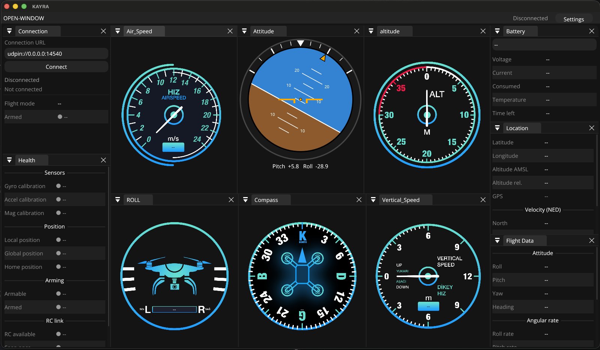

# KAYRA

KAYRA is a desktop ground control station for drones. It connects to a PX4/ArduPilot autopilot over MAVLink (through [MAVSDK](https://mavsdk.mavlink.io/)) and shows live flight data on cockpit-style gauges and telemetry panels.

It is written in C++17 with [Dear ImGui](https://github.com/ocornut/imgui) (docking branch), GLFW and OpenGL.



## Features

- **Six gauges** in the standard cockpit layout: airspeed, attitude (artificial horizon), altitude, roll, compass and vertical speed. Each gauge has a digital readout.
- **Telemetry panels:**
  - **Connection:** connection URL, connect/disconnect, status, flight mode
  - **Health:** sensor calibration, position estimates, arming, RC link
  - **Battery:** charge bar, voltage, current, consumption, temperature, time left
  - **Location:** latitude/longitude, altitude, GPS fix and satellites, velocity
  - **Flight Data:** attitude, rotation rates, airspeed, ground speed, climb rate, throttle
- **Fixed layout:** the windows open in the same place on every start (see the screenshot). You can rearrange them while the app runs, and the next start resets the layout.
- **Background connection:** connecting runs off the UI thread, so the interface never freezes. The status shows *Connecting*, *Connected*, *Link lost* or *Failed*.
- **Works without a drone:** values show `--` until data arrives. The attitude indicator runs a demo motion; right-click it for manual pitch/roll sliders.

## Project structure

| Path | What it contains |
| --- | --- |
| `main.cpp` | Creates the window and OpenGL context, sets up ImGui, runs the main loop |
| `Windows/Main_Window.cpp/.h` | Dock layout, menu bar, gauge windows, telemetry windows, telemetry→gauge mapping |
| `Windows/Attitude_Indicator.cpp/.h` | Artificial horizon drawn with ImGui shapes (no images) |
| `Windows/backend.cpp/.h` | MAVSDK connection and telemetry subscriptions; exposes thread-safe values to the GUI |
| `Windows/Widgets_Controls.cpp/.h` | Texture loading, rotated-image drawing, dark theme |
| `assets/` | Font (Open Sans) and gauge images |
| `dependencies/` | Bundled third-party code: ImGui, GLAD (OpenGL 3.3 loader), stb_image |
| `Dockerfile` | Ubuntu 24.04 build environment with GLFW, OpenCV and MAVSDK |
| `CMakeLists.txt` | Build script |

## Requirements

| Dependency | Version | Required? |
| --- | --- | --- |
| C++ compiler | C++17 (Clang, GCC or MSVC) | Yes |
| CMake | 3.12 or newer | Yes |
| GLFW | 3.x | Yes |
| OpenGL | 3.2 or newer | Yes |
| MAVSDK | 3.x or 4.x | Optional. Without it KAYRA still builds and runs, but cannot connect to a vehicle |

ImGui, GLAD and stb_image are already in `dependencies/`, so you don't install them.

---

## Setup from scratch

Pick your platform. Each section starts from a fresh machine.

### macOS (Apple Silicon or Intel)

1. Install Apple's command-line tools (compiler, git):

   ```bash
   xcode-select --install
   ```

2. Install [Homebrew](https://brew.sh) if you don't have it:

   ```bash
   /bin/bash -c "$(curl -fsSL https://raw.githubusercontent.com/Homebrew/install/HEAD/install.sh)"
   ```

3. Install the dependencies:

   ```bash
   brew install cmake glfw mavsdk
   ```

4. Clone and build:

   ```bash
   git clone https://github.com/timur-sezer/Kayra.git
   cd Kayra
   cmake -S . -B build
   cmake --build build -j
   ```

5. Run:

   ```bash
   ./build/KAYRA
   ```

### Linux (Ubuntu / Debian)

1. Install the build tools, GLFW and OpenGL headers:

   ```bash
   sudo apt update
   sudo apt install -y build-essential cmake git wget libglfw3-dev libgl1-mesa-dev
   ```

2. Install MAVSDK. Download the `libmavsdk-dev_<version>_<ubuntu-version>_<arch>.deb` package that matches your Ubuntu version and CPU (`amd64` or `arm64`) from the [MAVSDK releases page](https://github.com/mavlink/MAVSDK/releases). For example, on Ubuntu 24.04 x86-64:

   ```bash
   wget https://github.com/mavlink/MAVSDK/releases/download/v3.0.0/libmavsdk-dev_3.0.0_ubuntu24.04_amd64.deb
   sudo dpkg -i libmavsdk-dev_3.0.0_ubuntu24.04_amd64.deb
   ```

   If there is no package for your system, [build MAVSDK from source](https://mavsdk.mavlink.io/main/en/cpp/guide/build.html):

   ```bash
   git clone --recursive https://github.com/mavlink/MAVSDK.git
   cd MAVSDK
   cmake -B build -S . -DCMAKE_BUILD_TYPE=Release
   cmake --build build -j
   sudo cmake --install build
   cd ..
   ```

3. Clone and build:

   ```bash
   git clone https://github.com/timur-sezer/Kayra.git
   cd Kayra
   cmake -S . -B build
   cmake --build build -j
   ```

4. Run:

   ```bash
   ./build/KAYRA
   ```

### Windows 10/11

1. Install:
   - [Visual Studio 2022](https://visualstudio.microsoft.com/) (Community is fine) with the **Desktop development with C++** workload. This includes the compiler and CMake.
   - [Git for Windows](https://git-scm.com/download/win)
2. Open **x64 Native Tools Command Prompt for VS 2022** and install GLFW with [vcpkg](https://vcpkg.io):

   ```bat
   cd C:\
   git clone https://github.com/microsoft/vcpkg
   C:\vcpkg\bootstrap-vcpkg.bat
   C:\vcpkg\vcpkg install glfw3:x64-windows
   ```

3. Install MAVSDK. From the [MAVSDK releases page](https://github.com/mavlink/MAVSDK/releases), download `mavsdk-windows-x64-release.zip` and extract it to `C:\mavsdk`. It should contain `include\`, `lib\` and `bin\`.
4. Clone and build:

   ```bat
   git clone https://github.com/timur-sezer/Kayra.git
   cd Kayra
   cmake -S . -B build -DCMAKE_TOOLCHAIN_FILE=C:/vcpkg/scripts/buildsystems/vcpkg.cmake -DCMAKE_PREFIX_PATH=C:/mavsdk
   cmake --build build --config Release
   ```

5. Copy the MAVSDK DLL next to the executable, then run:

   ```bat
   copy C:\mavsdk\bin\mavsdk.dll build\Release\
   build\Release\KAYRA.exe
   ```

### Docker (Linux host)

The `Dockerfile` creates an Ubuntu 24.04 image with every dependency installed. The GUI is shown on the host's X11 display.

1. Install [Docker Engine](https://docs.docker.com/engine/install/).
2. Build the image from the repository root. The first build compiles OpenCV and takes a while.

   ```bash
   docker build -t kayra .
   ```

3. Allow the container to use your display, then start it with the project mounted at `/workspace`:

   ```bash
   xhost +local:docker
   docker run -it --rm \
       -e DISPLAY=$DISPLAY \
       -v /tmp/.X11-unix:/tmp/.X11-unix \
       --device /dev/dri \
       --net=host \
       -v $(pwd):/workspace \
       kayra
   ```

4. Inside the container, build into its own folder. Don't reuse the host's `build/`, because CMake caches absolute paths.

   ```bash
   cmake -S . -B build-docker
   cmake --build build-docker -j
   ./build-docker/KAYRA
   ```

> **Docker on macOS / Apple Silicon:** the Dockerfile installs the `amd64` MAVSDK package, so the build fails on an `arm64` machine unless you add `--platform linux/amd64`, which is slow. Docker also has no practical OpenGL 3 display on macOS. On a Mac, use the native macOS setup above.

---

## Connecting to a vehicle

1. Start KAYRA.
2. In the **Connection** window, enter a connection URL and press **Connect** (or Enter):

   | Source | URL |
   |---|---|
   | PX4 SITL (simulator) | `udpin://0.0.0.0:14540` (default) |
   | Telemetry forwarded to the usual GCS port | `udpin://0.0.0.0:14550` |
   | USB / telemetry radio (Linux/macOS) | `serial:///dev/ttyUSB0:57600` (or `/dev/tty.usbserial-*` on macOS) |
   | USB / telemetry radio (Windows) | `serial://COM3:57600` |

   > MAVSDK 2.x and older use `udp://:14540` instead of `udpin://`.

3. KAYRA waits up to 10 seconds for an autopilot heartbeat. The status in the Connection window and in the menu bar changes to **Connected**, and the gauges start moving.
4. If heartbeats stop, the status changes to **Link lost**, and it recovers automatically when they return. **Disconnect** (or **Cancel** while connecting) closes the link.

### Testing without hardware (PX4 SITL)

The easiest way to get live data is the PX4 simulator, best on Ubuntu. Follow the [PX4 development environment guide](https://docs.px4.io/main/en/dev_setup/dev_env.html), then:

```bash
git clone https://github.com/PX4/PX4-Autopilot.git --recursive
cd PX4-Autopilot
make px4_sitl gz_x500
```

When the simulator is running, connect KAYRA with `udpin://0.0.0.0:14540`.

## Using the interface

- **OPEN-WINDOW** menu: shows or hides any gauge or telemetry window. A check mark means the window is open.
- **Rearranging:** drag a window's tab to dock it somewhere else. Restart KAYRA to get the default layout back.
- **Attitude test controls:** right-click the Attitude window to set pitch/roll by hand or toggle the demo motion. Live telemetry takes over automatically once connected.
- **Gauge scales:**
  - Airspeed: 0–24 m/s
  - Altitude: 0–40 m above takeoff, one turn of the dial
  - Vertical speed: ±12 m/s, zero at 9 o'clock, climb turns clockwise
  - Compass: heading-up; the card rotates and the drone symbol always points up

## Troubleshooting

| Problem | Fix |
| --- | --- |
| `Could not find a package configuration file provided by "glfw3"` | GLFW isn't installed or CMake can't find it. Install it (see your platform), or pass `-DCMAKE_PREFIX_PATH=<glfw install dir>`. |
| CMake warning `MAVSDK not found: building without telemetry support` | Install MAVSDK, delete the `build/` folder and configure again. Without MAVSDK the Connect button reports that it is unavailable. |
| `KAYRA: failed to load texture ...` | The asset path is fixed when you configure CMake. If you moved the repository, delete `build/` and configure again. |
| Connection stays on *Connecting...* then shows *No autopilot found* | Check the vehicle or simulator is running and sending to that port, and that no other program (e.g. QGroundControl) is already using it. |
| Black window or `failed to initialize GLAD` | The GPU/driver must support OpenGL 3.2+. In Docker, make sure `--device /dev/dri` is passed and `xhost +local:docker` was run. |
| Windows: `mavsdk.dll was not found` | Copy `C:\mavsdk\bin\mavsdk.dll` next to `KAYRA.exe`. |

## License

See [LICENSE](LICENSE).
