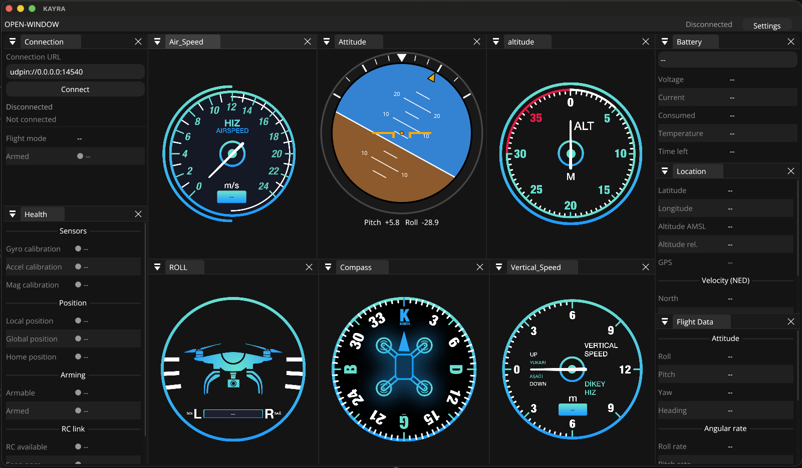
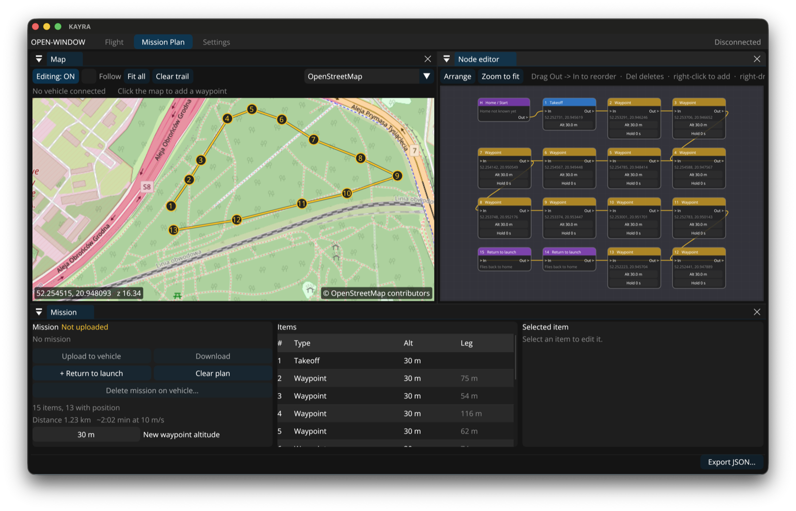

# KAYRA

KAYRA is a desktop ground control station for drones. It connects to a PX4/ArduPilot autopilot over MAVLink (through [MAVSDK](https://mavsdk.mavlink.io/)), shows live flight data on cockpit-style gauges and telemetry panels, and plans missions on a map and in a node editor.

It is written in C++17 with [Dear ImGui](https://github.com/ocornut/imgui) (docking branch), GLFW and OpenGL.





## Features

The top bar has three tabs: **Flight**, **Mission Plan** and **Settings**. KAYRA reopens the tab you used last.

### Flight

- **Six gauges** in the standard cockpit layout: airspeed, attitude (artificial horizon), altitude, roll, compass and vertical speed. Each gauge has a digital readout.
- **Telemetry panels:**
  - **Connection:** connection URL, connect/disconnect, status, flight mode
  - **Health:** sensor calibration, position estimates, arming, RC link
  - **Battery:** charge bar, voltage, current, consumption, temperature, time left
  - **Location:** latitude/longitude, altitude, GPS fix and satellites, velocity
  - **Flight Data:** attitude, rotation rates, airspeed, ground speed, climb rate, throttle
- **Background connection:** connecting runs off the UI thread, so the interface never freezes. The status shows *Connecting*, *Connected*, *Link lost* or *Failed*.
- **Works without a drone:** values show `--` until data arrives. The attitude indicator runs a demo motion; right-click it for manual pitch/roll sliders.

### Mission Plan

Three separate windows that edit the same plan. By default **Map** and **Node editor** are side by side and **Mission** runs along the bottom; each one can be dragged, resized, docked elsewhere, closed and reopened.

- **Map:** OpenStreetMap or satellite tiles with the live vehicle (heading arrow), the path it has flown, the home position and the mission. Click to add waypoints, drag them to move them. While a mission runs, the **next waypoint** is highlighted with its distance and bearing. Tiles are cached on disk, so areas you have viewed also work offline.
- **Node editor:** the mission as a graph ([imgui-node-editor](https://github.com/thedmd/imgui-node-editor)): one node per item, linked in flight order from a *Home / Start* node. Drag links to reorder, edit altitude and hold time in the nodes, right-click to add items.
- **Mission:** upload to / download from the vehicle, item list, editor for the selected item (type, position, altitude, hold time), distance and flight-time estimate.
- **Export JSON:** saves the plan through the system's save dialog in QGroundControl's `.plan` format, so it opens in QGroundControl and loads with MAVSDK's `import_qgroundcontrol_mission`.

### Settings

Theme (KAYRA Dark, ImGui Dark, Light, Classic), accent color, UI scale and corner rounding; default connection URL and connect-on-startup; map tiles, trail, follow and the tile cache; mission defaults; which windows are shown, and layout resets. Changes apply immediately and are saved automatically.

## Project structure

| Path | What it contains |
| --- | --- |
| `main.cpp` | Creates the window and OpenGL context, sets up ImGui, runs the main loop |
| `Windows/Main_Window.cpp/.h` | Top bar and tabs, dock layouts, gauge windows, telemetry windows, telemetry→gauge mapping |
| `Windows/Attitude_Indicator.cpp/.h` | Artificial horizon drawn with ImGui shapes (no images) |
| `Windows/backend.cpp/.h` | MAVSDK connection, telemetry subscriptions, mission download/upload/clear; thread-safe values for the GUI |
| `Windows/Mission_Plan.cpp/.h` | Mission Plan tab: Map, Node editor and Mission windows, plan editing |
| `Windows/Mission_Export.cpp/.h` | Mission → JSON (QGroundControl `.plan` format) |
| `Windows/File_Dialog*.{h,cpp,mm}` | Native save dialog: NSSavePanel (macOS), GetSaveFileName (Windows), zenity/kdialog (Linux) |
| `Windows/Settings.cpp/.h` | Settings tab, settings file, theme/scale/accent styling |
| `Windows/Widgets_Controls.cpp/.h` | Texture loading, rotated-image drawing, dark theme |
| `Map/` | Map widget and threaded tile downloader (from [Opengl-WorldMap](https://github.com/timur-sezer/Opengl-WorldMap)) |
| `tools/kayra_sim.cpp` | `kayra-sim`, a fake vehicle that flies a demo mission, for testing without PX4 |
| `assets/` | Font (Open Sans) and gauge images |
| `dependencies/` | Bundled third-party code: ImGui, imgui-node-editor, GLAD (OpenGL 3.3 loader), stb_image |
| `docs/` | Screenshots |
| `Dockerfile` | Ubuntu 24.04 build environment with GLFW, libcurl, OpenCV and MAVSDK |
| `CMakeLists.txt` | Build script |

## Requirements

| Dependency | Version | Required? |
| --- | --- | --- |
| C++ compiler | C++17 (Clang, GCC or MSVC) | Yes |
| CMake | 3.12 or newer | Yes |
| GLFW | 3.x | Yes |
| OpenGL | 3.2 or newer | Yes |
| libcurl | any | Yes, downloads map tiles (ships with macOS) |
| MAVSDK | 3.x or 4.x | Optional. Without it KAYRA still builds and runs, but cannot connect to a vehicle |
| zenity or kdialog | any | Linux only, optional. Needed for the **Export JSON** save dialog |

ImGui, imgui-node-editor, GLAD and stb_image are already in `dependencies/`, so you don't install them.

---

## Setup from scratch

Pick your platform. Each section starts from a fresh machine.

### macOS (Apple Silicon or Intel)

1. Install Apple's command-line tools (compiler, git):

   ```bash
   xcode-select --install
   ```

2. Install [Homebrew](https://brew.sh) if you don't have it:

   ```bash
   /bin/bash -c "$(curl -fsSL https://raw.githubusercontent.com/Homebrew/install/HEAD/install.sh)"
   ```

3. Install the dependencies:

   ```bash
   brew install cmake glfw mavsdk
   ```

4. Clone and build:

   ```bash
   git clone https://github.com/timur-sezer/Kayra.git
   cd Kayra
   cmake -S . -B build
   cmake --build build -j
   ```

5. Run:

   ```bash
   ./build/KAYRA
   ```

### Linux (Ubuntu / Debian)

1. Install the build tools, GLFW, OpenGL and libcurl headers, and zenity for the save dialog:

   ```bash
   sudo apt update
   sudo apt install -y build-essential cmake git wget libglfw3-dev libgl1-mesa-dev libcurl4-openssl-dev zenity
   ```

2. Install MAVSDK. Download the `libmavsdk-dev_<version>_<ubuntu-version>_<arch>.deb` package that matches your Ubuntu version and CPU (`amd64` or `arm64`) from the [MAVSDK releases page](https://github.com/mavlink/MAVSDK/releases). For example, on Ubuntu 24.04 x86-64:

   ```bash
   wget https://github.com/mavlink/MAVSDK/releases/download/v3.0.0/libmavsdk-dev_3.0.0_ubuntu24.04_amd64.deb
   sudo dpkg -i libmavsdk-dev_3.0.0_ubuntu24.04_amd64.deb
   ```

   If there is no package for your system, [build MAVSDK from source](https://mavsdk.mavlink.io/main/en/cpp/guide/build.html):

   ```bash
   git clone --recursive https://github.com/mavlink/MAVSDK.git
   cd MAVSDK
   cmake -B build -S . -DCMAKE_BUILD_TYPE=Release
   cmake --build build -j
   sudo cmake --install build
   cd ..
   ```

3. Clone and build:

   ```bash
   git clone https://github.com/timur-sezer/Kayra.git
   cd Kayra
   cmake -S . -B build
   cmake --build build -j
   ```

4. Run:

   ```bash
   ./build/KAYRA
   ```

### Windows 10/11

1. Install:
   - [Visual Studio 2022](https://visualstudio.microsoft.com/) (Community is fine) with the **Desktop development with C++** workload. This includes the compiler and CMake.
   - [Git for Windows](https://git-scm.com/download/win)
2. Open **x64 Native Tools Command Prompt for VS 2022** and install GLFW and curl with [vcpkg](https://vcpkg.io):

   ```bat
   cd C:\
   git clone https://github.com/microsoft/vcpkg
   C:\vcpkg\bootstrap-vcpkg.bat
   C:\vcpkg\vcpkg install glfw3:x64-windows curl:x64-windows
   ```

3. Install MAVSDK. From the [MAVSDK releases page](https://github.com/mavlink/MAVSDK/releases), download `mavsdk-windows-x64-release.zip` and extract it to `C:\mavsdk`. It should contain `include\`, `lib\` and `bin\`.
4. Clone and build:

   ```bat
   git clone https://github.com/timur-sezer/Kayra.git
   cd Kayra
   cmake -S . -B build -DCMAKE_TOOLCHAIN_FILE=C:/vcpkg/scripts/buildsystems/vcpkg.cmake -DCMAKE_PREFIX_PATH=C:/mavsdk
   cmake --build build --config Release
   ```

5. Copy the MAVSDK DLL next to the executable, then run:

   ```bat
   copy C:\mavsdk\bin\mavsdk.dll build\Release\
   build\Release\KAYRA.exe
   ```

### Docker (Linux host)

The `Dockerfile` creates an Ubuntu 24.04 image with every dependency installed. The GUI is shown on the host's X11 display.

1. Install [Docker Engine](https://docs.docker.com/engine/install/).
2. Build the image from the repository root. The first build compiles OpenCV and takes a while.

   ```bash
   docker build -t kayra .
   ```

3. Allow the container to use your display, then start it with the project mounted at `/workspace`:

   ```bash
   xhost +local:docker
   docker run -it --rm \
       -e DISPLAY=$DISPLAY \
       -v /tmp/.X11-unix:/tmp/.X11-unix \
       --device /dev/dri \
       --net=host \
       -v $(pwd):/workspace \
       kayra
   ```

4. Inside the container, build into its own folder. Don't reuse the host's `build/`, because CMake caches absolute paths.

   ```bash
   cmake -S . -B build-docker
   cmake --build build-docker -j
   ./build-docker/KAYRA
   ```

> **Docker on macOS / Apple Silicon:** the Dockerfile installs the `amd64` MAVSDK package, so the build fails on an `arm64` machine unless you add `--platform linux/amd64`, which is slow. Docker also has no practical OpenGL 3 display on macOS. On a Mac, use the native macOS setup above.

---

## Connecting to a vehicle

1. Start KAYRA.
2. In the **Connection** window (Flight tab), enter a connection URL and press **Connect** (or Enter):

   | Source | URL |
   |---|---|
   | PX4 SITL (simulator) | `udpin://0.0.0.0:14540` (default) |
   | Telemetry forwarded to the usual GCS port | `udpin://0.0.0.0:14550` |
   | USB / telemetry radio (Linux/macOS) | `serial:///dev/ttyUSB0:57600` (or `/dev/tty.usbserial-*` on macOS) |
   | USB / telemetry radio (Windows) | `serial://COM3:57600` |

   > MAVSDK 2.x and older use `udp://:14540` instead of `udpin://`.

3. KAYRA waits up to 10 seconds for an autopilot heartbeat. The status in the Connection window and in the top bar changes to **Connected**, the gauges start moving, and the vehicle's mission is downloaded into the Mission Plan tab.
4. If heartbeats stop, the status changes to **Link lost**, and it recovers automatically when they return. **Disconnect** (or **Cancel** while connecting) closes the link.

Other ways to connect:

- Pass the URL on the command line: `./build/KAYRA udpin://0.0.0.0:14540`.
- Turn on **Settings → Connection → Connect on startup**.

### Testing without hardware (kayra-sim)

When MAVSDK is installed, the build also produces `kayra-sim`, a small fake vehicle. It loads a demo mission near Zurich (PX4's default home position) and flies it, sending the same MAVLink messages as a real autopilot. It also accepts missions uploaded from KAYRA and flies those instead.

```bash
./build/kayra-sim                       # sends to udpout://127.0.0.1:14540
./build/KAYRA udpin://0.0.0.0:14540     # in a second terminal
```

Optional arguments: `kayra-sim <url> <home_lat> <home_lon>`.

### Testing without hardware (PX4 SITL)

For a full simulation, use the PX4 simulator, best on Ubuntu. Follow the [PX4 development environment guide](https://docs.px4.io/main/en/dev_setup/dev_env.html), then:

```bash
git clone https://github.com/PX4/PX4-Autopilot.git --recursive
cd PX4-Autopilot
make px4_sitl gz_x500
```

When the simulator is running, connect KAYRA with `udpin://0.0.0.0:14540`.

## Using the interface

### Windows and layout

- **OPEN-WINDOW** shows or hides the windows of the current tab: gauges and telemetry in Flight; Map, Node editor and Mission in Mission Plan. A check mark means the window is open. **Reset layout** puts the tab's windows back in their default places.
- Drag a window's title tab to dock it somewhere else, or drag a divider to resize. Each tab keeps its own arrangement while KAYRA runs; on the next start the default layout is used again.
- Which windows are open is remembered. **Settings → Windows** has the same switches and the layout resets.

### Flight tab

- **Attitude test controls:** right-click the Attitude window to set pitch/roll by hand or toggle the demo motion. Live telemetry takes over automatically once connected.
- **Gauge scales:**
  - Airspeed: 0–24 m/s
  - Altitude: 0–40 m above takeoff, one turn of the dial
  - Vertical speed: ±12 m/s, zero at 9 o'clock, climb turns clockwise
  - Compass: heading-up; the card rotates and the drone symbol always points up

### Mission Plan tab

All three windows show the same plan, and selection is shared: clicking a waypoint on the map, a node, or a row in the list selects the same item everywhere. Item numbers match in all three.

#### Map window

| Action | How |
| --- | --- |
| Pan / zoom | Drag the map / mouse wheel |
| Add a waypoint | With **Editing: ON**, click the map. It is inserted after the selected item, or at the end. The first waypoint of an empty plan becomes a takeoff (can be turned off in **Settings → Mission planning**) |
| Move a waypoint | With **Editing: ON**, drag it |
| Read coordinates | With **Editing: OFF**, click to drop a pin; the cursor position is always shown in the bottom-left corner |
| Keep the vehicle centered | **Follow** (dragging the map turns it off) |
| Show everything | **Fit all** zooms to the mission, vehicle and home |
| Change tiles | Dropdown on the right: OpenStreetMap or Esri satellite |

While a mission runs, yellow legs are still to fly, grey ones are done, and the next waypoint is green with a dashed line from the vehicle. The status line above the map shows its distance, bearing and altitude.

#### Node editor window

| Action | How |
| --- | --- |
| Reorder | Drag from a node's *Out* pin to another node's *In* pin: that node then comes right after it |
| Edit | Altitude and hold/loiter time directly in the node |
| Add an item | Right-click the background: waypoint, takeoff, loiter, land or return to launch (inserted after the selected item) |
| Move / delete an item | Right-click the node, or select it and press Delete |
| Pan / zoom | Right-drag / mouse wheel; **Zoom to fit** shows all nodes, **Arrange** re-lays them out |

The node being flown to is outlined green and its incoming link animates.

#### Mission window

- **Upload to vehicle** sends the plan. **Download** replaces the plan with the vehicle's mission (it asks first if you have changes that are not uploaded).
- **+ Return to launch** appends a return-to-launch item. **Clear plan** empties the plan here; **Delete mission on vehicle...** removes the mission stored on the vehicle.
- The header says whether the plan is *Same as vehicle* or *Not uploaded*, and shows the total distance and estimated flight time.
- Select an item to edit its type (waypoint, takeoff, loiter, land, return to launch), latitude/longitude, altitude above home and hold/loiter time. **Move up/down** reorders it, **Delete** (or the Delete key) removes it.
- Items without a position, such as speed changes, stay in the plan and are uploaded and exported, but are not drawn on the map.
- When the window is docked wide, it shows three columns (plan | items | selected item); when it is tall, one column.

**Export JSON...** (bottom-right corner) asks where to save and writes the current plan, including changes that are not uploaded, as JSON in QGroundControl's `.plan` format. Rename the file to `.plan` to open it from QGroundControl's file dialog.

### Settings tab

| Section | What you can change |
| --- | --- |
| Appearance | Theme, accent color, UI scale, corner rounding |
| Connection | Default connection URL, connect on startup, connect/disconnect |
| Map | Default tiles, flight trail, follow the vehicle on connect, tile cache size and **Clear cache** |
| Mission planning | Default altitude for new waypoints, start new plans with a takeoff, cruise speed for the time estimate |
| Windows | Which Flight and Mission Plan windows are open, layout resets |
| About | Versions, settings file location, **Reset all settings** |

### Files KAYRA writes

| What | macOS | Linux | Windows |
| --- | --- | --- | --- |
| Settings | `~/Library/Application Support/KAYRA/settings.ini` | `~/.config/KAYRA/settings.ini` | `%APPDATA%\KAYRA\settings.ini` |
| Map tile cache | `~/Library/Caches/KAYRA/tiles/` | `~/.cache/KAYRA/tiles/` | `%LOCALAPPDATA%\KAYRA\tiles\` |

### Map tile usage

The built-in tile sources are public servers meant for light use. OpenStreetMap tiles follow the [OSM Tile Usage Policy](https://operations.osmfoundation.org/policies/tiles/) (KAYRA sends an identifying User-Agent and shows the required attribution); Esri World Imagery is subject to Esri's terms. For heavier use, switch to a provider with API keys or host your own tiles.

## Troubleshooting

| Problem | Fix |
| --- | --- |
| `Could not find a package configuration file provided by "glfw3"` | GLFW isn't installed or CMake can't find it. Install it (see your platform), or pass `-DCMAKE_PREFIX_PATH=<glfw install dir>`. |
| `Could NOT find CURL` | Install libcurl's development package (`libcurl4-openssl-dev` on Ubuntu, `curl:x64-windows` with vcpkg). |
| CMake warning `MAVSDK not found: building without telemetry support` | Install MAVSDK, delete the `build/` folder and configure again. Without MAVSDK the Connect button reports that it is unavailable. |
| `KAYRA: failed to load texture ...` or `The source directory ... does not exist` | CMake stores absolute paths. If you moved the repository, delete `build/` and configure again. |
| Connection stays on *Connecting...* then shows *No autopilot found* | Check the vehicle or simulator is running and sending to that port, and that no other program (e.g. QGroundControl) is already using it. |
| Map stays grey | Tiles need internet the first time an area is viewed. Check the connection or proxy; errors are printed to the terminal as `KAYRA: map tile ... failed`. |
| Mission Plan shows *Not uploaded* after connecting | You have local edits. Press **Upload to vehicle** to send them, or **Download** to replace them with the vehicle's mission. |
| Linux: *No file dialog available* when exporting | Install `zenity` (GNOME) or `kdialog` (KDE). |
| Black window or `failed to initialize GLAD` | The GPU/driver must support OpenGL 3.2+. In Docker, make sure `--device /dev/dri` is passed and `xhost +local:docker` was run. |
| Windows: `mavsdk.dll was not found` | Copy `C:\mavsdk\bin\mavsdk.dll` next to `KAYRA.exe`. |

## Acknowledgements

- [Dear ImGui](https://github.com/ocornut/imgui) by Omar Cornut (MIT)
- [imgui-node-editor](https://github.com/thedmd/imgui-node-editor) by Michał Cichoń (MIT)
- [MAVSDK](https://github.com/mavlink/MAVSDK) (BSD-3-Clause)
- [GLFW](https://www.glfw.org/), [GLAD](https://github.com/Dav1dde/glad) and [stb_image](https://github.com/nothings/stb)
- Map data © [OpenStreetMap contributors](https://www.openstreetmap.org/copyright); satellite imagery © Esri
- [Open Sans](https://fonts.google.com/specimen/Open+Sans) font (SIL Open Font License)

## License

See [LICENSE](LICENSE).
